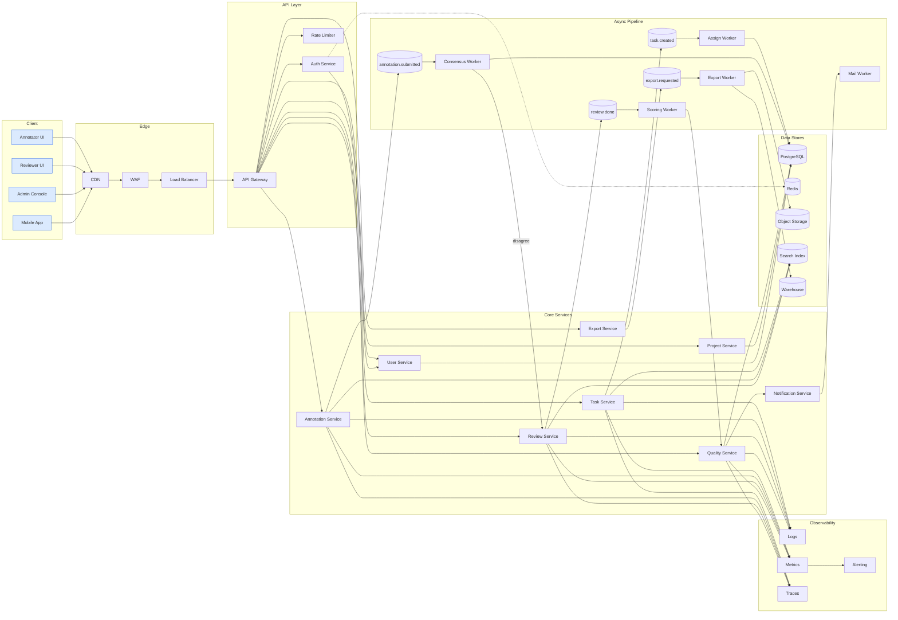
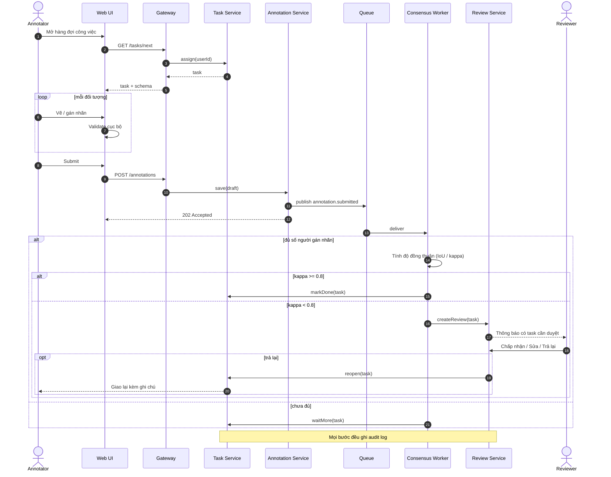
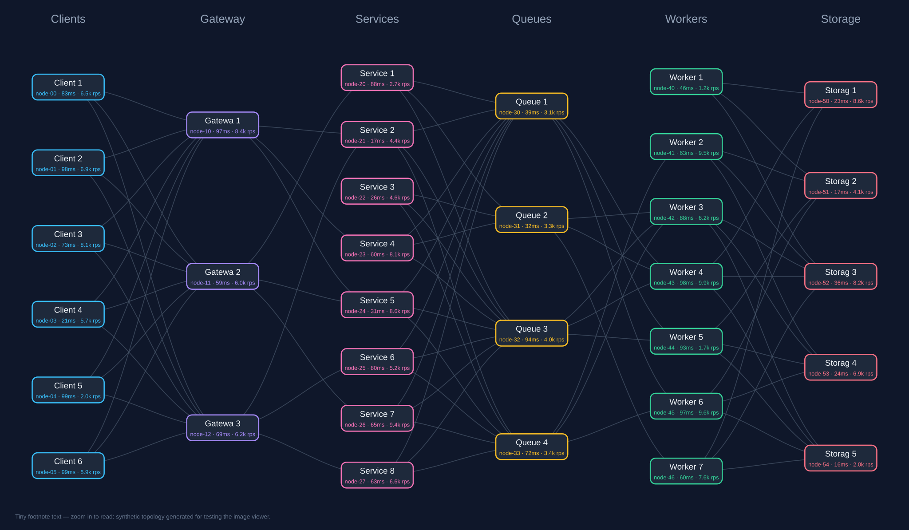
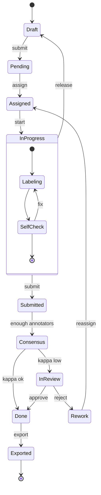

# Zoom test — complex diagrams

Bấm vào hình để mở khung xem, lăn chuột để zoom, kéo để pan.

## 1. Sơ đồ Mermaid lớn (flowchart nhiều subgraph)

## 2. Sequence diagram dài

## 3. Ảnh SVG lớn 2400×1400 (chữ nhỏ, cần zoom)

## 4. State diagram

